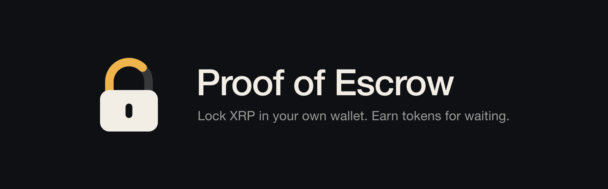

<p align="center"></p>

# Proof of Escrow

An open protocol for distributing a token on the XRP Ledger to people who lock XRP in their own wallets.

You lock XRP in an escrow to yourself. A distribution pays out its token, a little every day, to everyone who has XRP locked, in proportion to how much they locked and how long the lock still has to run. When the lock ends, the XRP comes back to you. Nobody pays the project anything, and your XRP never leaves your account.

It comes from [Ledger on Ledger](docs/LOL.md), which ran for a year on XRP Ledger mainnet. 31 accounts locked 3,856 XRP to take part, for a median of five years.

## Why

Most token launches ask people to buy in. This one asks them to wait.

- **Holders keep their XRP.** It stays in their own account, locked by the ledger itself, and comes back on the date they chose.
- **Patience is the only way in.** There is no sale and nothing to buy. A bigger share takes more XRP locked for longer, so the token goes to people who have shown they will hold for years.
- **XRP comes off the market.** Every lock keeps XRP out of circulation until it opens. One distribution moves little. Many of them, run by projects with real reach, could keep a meaningful amount of XRP held for years by people who chose to hold it.

Projects get a fair launch to committed holders, and holders get paid for patience. Lifting holders lifts the whole community.

## How it works

1. **Lock.** Sign an `EscrowCreate` to your own address with a `FinishAfter` date. Any wallet can do it. The XRP Ledger keeps the XRP locked until that date.
2. **Opt in.** Set a trust line to the distribution's token. That is how you get paid, and how the calculator finds you.
3. **Earn.** Every epoch (a day by default) the distribution splits that epoch's tokens by XRP locked times the time left on each lock, capped at five years. 100 XRP with five years left counts five times as much as 100 XRP with one year left.
4. **Check.** Every payment carries the hash of the report behind it. Anyone can rebuild the report from the ledger and get the same numbers.

The full rules are in [SPEC.md](SPEC.md).

## Trust

The lock is trustless: it is a native escrow, and nobody but the owner can ever touch it.

The payouts are only as decentralized as whoever signs them. Proof of Escrow defines three levels:

| Level | What you trust |
|---|---|
| 1. Verifiable | One payer to pay. Any wrong payment is provable from the ledger. |
| 2. Federated | A quorum of independent signers on the pool account not to collude |
| 3. On-ledger | The ledgers themselves |

Levels 1 and 2 work on the XRP Ledger today. Level 3 works on Xahau now, and becomes fully on-ledger for XRP Ledger tokens once Xahau's Export ships. [docs/DECENTRALIZATION.md](docs/DECENTRALIZATION.md) covers every route, including Evernode and the XRPL EVM, and what each one trusts.

## Reference calculator

[`reference/`](reference) computes epoch reports, verifies them, and builds the unsigned payments. It is read-only, holds no keys, and needs nothing but Node 22.18 or later.

```bash
cd reference
npm test                                                   # unit tests and test vectors
node src/cli.ts id examples/testnet/manifest.json          # distribution id and anchor memo
node src/cli.ts epoch manifest.json 0 --out report-0.json  # build epoch 0 from the ledger
node src/cli.ts verify manifest.json report-0.json         # rebuild a report and compare
node src/cli.ts payouts manifest.json report-0.json --sequence 123 --fee 12
```

It reads from `https://xrplcluster.com/` by default (`--rpc` to change). For anything large, point it at your own server.

## Get involved

The spec is a draft and wants review. What would help most:

- A second implementation, in any language, that matches the [test vectors](reference/examples/testnet).
- Review of the weight formula and epoch rules in [SPEC.md](SPEC.md).
- Independent signers for a level 2 distribution.
- A Xahau Hook that verifies imported locks with `xpop_slot`.

Open an issue to discuss. Report security problems privately, as described in [SECURITY.md](SECURITY.md).

## Status

Draft 0.1. The spec and the reference calculator have run end to end on XRP Ledger testnet. No mainnet distribution uses this version yet.

## License

[MIT](LICENSE)
